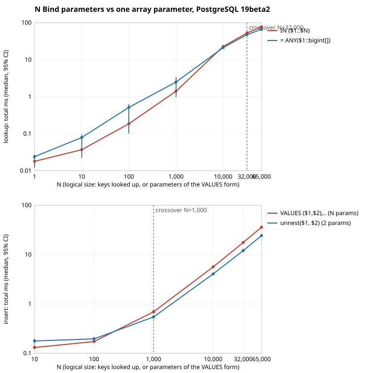

# Query parameters: 65,535

The [Limits appendix](https://www.postgresql.org/docs/current/limits.html) lists
**query parameters: 65,535**. This chapter measures what happens on the way there and
at the wall itself, on your machine:

- **(A) the cost curve.** The same logical operation done two ways for
  N = 1 ... 65,000: with N Bind parameters (`IN ($1, ..., $N)`, a multi-row `VALUES`),
  and with one array parameter (`= ANY($1::bigint[])`, `unnest($1, $2)`) that has no
  such limit. Medians and 95% confidence intervals over 15 rounds, with planning and
  execution time from `EXPLAIN (ANALYZE)` next to the client-side total.
- **(B) the hard wall, triggered rather than quoted.** 65,535 parameters go through and
  65,536 do not, through libpq and over the raw protocol. Then the same lookup with two
  million keys in a single parameter.
- **(C) the practical crossover.** The smallest N from which the one-parameter form is
  faster, read from the data.

Every statement uses the extended query protocol (`PQexecParams`), so the values are
real Bind parameters. Nothing is measured with literals in the SQL text.

This is a **reproducible demonstration of known behaviour**, not a new finding.
People who work on PostgreSQL know the limit and the array idiom. What the kit adds is
the numbers, on your hardware, with a confidence interval.

## Quick start

```sh
PG_CONFIG=/usr/lib/postgresql/18/bin/pg_config ./param_limits.sh
```

It needs a C compiler, the libpq headers (`libpq-dev` / `libpq-devel`), `python3`
(standard library only), and `initdb`, `pg_ctl` and `psql` from the build under test. It
starts a throwaway server on a Unix socket, so nothing touches an existing cluster. A
full run took about 22 seconds on the machine below, and 1.1 GB of disk (data plus WAL).

| variable | default | meaning |
|---|---|---|
| `PG_CONFIG` | `pg_config` in PATH | build to test (the libpq client is compiled against it too) |
| `ROWS` | 3000000 | rows in `t(id bigint primary key, payload text)` |
| `ROUNDS` | 15 | measured rounds per point, after one warm-up round |
| `PARAM_STEPS` | `1 10 100 1000 10000 32000 65000` | values of N |
| `WALL_ARRAY` | 2000000 | keys in the one-parameter array of (B) |
| `WORKDIR` | `./param-limits-work` | scratch directory, wiped at start |
| `PORT` | 5611 | server port (Unix socket only) |
| `SHARED_BUFFERS` | 1GB | |
| `CC` | `cc` | C compiler |
| `KEEP` | 0 | 1 = keep the data directory |
| `ALLOW_ASSERTS` | 0 | 1 = run on a build with `--enable-cassert` anyway |
| `SOCKET_DIR` | fresh dir under `/tmp` | where the Unix socket goes |

The script refuses builds configured with `--enable-cassert`, and servers with
`debug_assertions = on`. Their timings say nothing about production.

## How it measures

- **Data.** 3M rows (377 MB with the index), `VACUUM ANALYZE`d, prewarmed with
  `pg_prewarm` when available. The lookups are real primary-key index probes.
- **Lookups.** Each round draws N random keys, and both approaches get the same keys.
  The query returns `id, payload` for every match.
- **Inserts.** These go into an empty `ins(id bigint primary key, payload text)` that is
  truncated before every statement. The `VALUES` form has two parameters per row, so N
  parameters insert N/2 rows. The `unnest` form inserts the same rows with 2 parameters.
  The insert points start at N = 10.
- **Order.** Within a round, the two approaches alternate which one runs first.
- **What the columns mean.**
  - `total`: the client-side wall time of `PQexecParams` (send, parse, plan, execute,
    receive).
  - `plan` and `exec`: Planning Time and Execution Time from a second run of the same
    statement, with the same parameters, under `EXPLAIN (ANALYZE, TIMING OFF)`.
  - What neither column covers (parse analysis, Bind, the network, building the rows)
    is only in `total`.
- **Server settings.** `synchronous_commit = off` and `jit = off`, so that neither commit
  flushes nor JIT compilation get into a comparison about parameter handling.
- **Confidence intervals.** The 95% CI of each median comes from order statistics, so it
  assumes nothing about the shape of the timing distribution.

Outputs in `WORKDIR`:
- `raw.csv`: one row per statement.
- `summary.csv`: median and CI per point and metric.
- `summary.txt`: what the script printed.
- `wall.txt`: the (B) outcomes, verbatim.
- `params.svg`: the plot.
- `environment.txt`.

## Example output (one laptop, not a benchmark)

**Machine.**
- AMD Ryzen AI 9 HX 370; the run was pinned to four Zen 5 cores (8 hardware threads).
- 30 GB RAM; Kingston KC3000 NVMe on btrfs; Linux 7.2.
- PostgreSQL 19beta2 built with `-O2`, no assertions.

**Runs.** Two full runs, back to back. Their complete outputs are in
[`example/run1`](example/run1) and [`example/run2`](example/run2). The tables below are
run 1.

### (B) The wall

```
wall n_params=65535 status=ok matched=64812 ms=124.0
wall n_params=65536 status=error message="number of parameters must be between 0 and 65535"
wire n_params=65535 bind_count_field=65535 status=ok matched=64812
wire n_params=65536 bind_count_field=0 status=error sqlstate=08P01 message="bind message supplies 0 parameters, but prepared statement "" requires 65536"
bigarray n_params=1 elements=2000000 param_bytes=15257698 status=ok matched=1459167 ms=939.3
```

**`wall`: through libpq, as an application would.** libpq refuses 65,536 parameters
before anything is sent (`PQ_QUERY_PARAM_MAX_LIMIT` in `libpq-fe.h`).

**`wire`: raw protocol 3.0, no libpq.** This line is there so that the client-side check
is not the whole story.
- The parameter count in the Bind message is an Int16 field. 65,535 fits, and the raw
  client gets the same answer as libpq (`matched=64812`). That also shows the raw client
  works.
- 65,536 does not fit: written into the field it becomes 0. The server accepted the
  Parse with `$65536` in it, and rejects the Bind.
- So the limit is the wire format itself. No setting changes it.

**`bigarray`: the same lookup with 2,000,000 keys in one parameter (15 MB).** It goes
through. It is not free (about a second here), but the cap does not apply.

### (A) The cost curve

Total, planning and execution time are medians in ms over 15 rounds; the brackets are
the 95% CI of the total. The ratio is capped total / one-parameter total.

**Lookup**: `IN ($1..$N)` vs `= ANY($1::bigint[])`

| N | IN total | plan | exec | ANY total | plan | exec | ratio |
|---:|---|---:|---:|---|---:|---:|---:|
| 1 | 0.018 [0.012..0.025] | 0.002 | 0.001 | 0.024 [0.013..0.027] | 0.002 | 0.001 | 0.75x |
| 10 | 0.037 [0.023..0.079] | 0.004 | 0.006 | 0.079 [0.022..0.097] | 0.003 | 0.007 | 0.47x |
| 100 | 0.186 [0.110..0.625] | 0.013 | 0.065 | 0.516 [0.100..0.616] | 0.009 | 0.064 | 0.36x |
| 1,000 | 1.404 [1.070..3.416] | 0.100 | 0.767 | 2.488 [0.960..3.210] | 0.060 | 0.795 | 0.56x |
| 10,000 | 22.8 [22.2..23.7] | 0.990 | 18.9 | 21.2 [20.5..22.2] | 0.596 | 18.6 | 1.07x |
| 32,000 | 52.8 [52.5..53.4] | 3.091 | 40.3 | 47.6 [47.2..48.4] | 1.806 | 40.2 | 1.11x |
| 65,000 | 77.1 [76.6..80.2] | 6.292 | 53.0 | 66.1 [65.7..66.9] | 3.662 | 52.3 | 1.17x |

**Insert**: `VALUES ($1,$2),...` (N parameters, N/2 rows) vs `unnest($1, $2)` (2 parameters)

| N | VALUES total | plan | exec | unnest total | plan | exec | ratio |
|---:|---|---:|---:|---|---:|---:|---:|
| 10 | 0.131 [0.126..0.150] | 0.012 | 0.068 | 0.178 [0.156..0.196] | 0.019 | 0.076 | 0.74x |
| 100 | 0.173 [0.166..0.184] | 0.017 | 0.092 | 0.196 [0.190..0.214] | 0.018 | 0.097 | 0.88x |
| 1,000 | 0.693 [0.668..0.719] | 0.043 | 0.418 | 0.544 [0.540..0.592] | 0.019 | 0.415 | 1.27x |
| 10,000 | 5.629 [5.405..6.096] | 0.322 | 3.595 | 4.051 [3.910..4.190] | 0.027 | 3.632 | 1.39x |
| 32,000 | 17.6 [17.2..18.7] | 0.993 | 10.8 | 12.0 [11.8..13.2] | 0.038 | 10.8 | 1.46x |
| 65,000 | 35.9 [35.0..37.0] | 2.027 | 22.1 | 24.3 [23.7..25.1] | 0.053 | 22.5 | 1.48x |



### (C) The crossover

```
lookup: by median N=10,000; with non-overlapping 95% CIs N=32,000
insert: by median N=1,000; with non-overlapping 95% CIs N=1,000
```

Run 2 gave the same crossovers by median. With non-overlapping CIs, insert was again
N = 1,000, and lookup was N = 10,000: at that point the two intervals of run 1 touch
(22.2 vs 22.2 when rounded). 23 of the 26 medians of run 2 fall inside the CIs of run 1. The
three that do not are `any_array` at 10,000 and `insert_unnest` at 100 and 10,000, and
the furthest of them is 7% below the interval.

## How to read it

What this run says. What yours says may differ.

- **It is not a cliff.** Both forms grow roughly linearly with N, because execution
  dominates and execution is nearly identical in the two (`exec` columns). The probes
  into the index cost the same however the keys arrived.
- **The difference is the per-parameter overhead.**
  - Planning is about 1.7x slower with N parameters for lookups, and up to 38x for
    inserts (at 65,000).
  - On top of that, the IN-list pays for work that `EXPLAIN` does not time (parse
    analysis, the Bind message with N values). It shows up only in `total`.
  - At 65,000 that adds up to 1.17x for lookups and 1.48x for inserts.
- **Below about a thousand keys, the N-parameter form is not slower.**
  - For lookups it is often faster, though the CIs from 10 to 1,000 are wide and
    overlap.
  - For inserts, `VALUES` wins at 10 with separated CIs in both runs. At 100 it wins
    in run 1, while in run 2 the two CIs touch.
- **The practical crossover comes long before the hard limit.** Here it is around
  1,000 parameters for inserts and 10,000 for lookups.
  - Above it, the N-parameter form is both slower and capped.
  - The array form is faster there and has no cap: (B) put two million keys through it.

## Known limitations

- **65,535 is a protocol constant.** It is the Int16 parameter count of the Bind message,
  and nothing in PostgreSQL's configuration changes it. (B) shows it from both sides.
- **The numbers are this machine's.** They depend on the hardware, the PostgreSQL version,
  the client library, and the shape of the data. Small-N points are a few microseconds
  and noisy: read their CIs.
  - Other drivers build the Bind message their own way. JDBC, for example, has its own
    batching and array handling. Their curves can differ from libpq's.
- **One table shape.** These are single-column lookups and two-column inserts. Wider rows
  multiply the per-row parameter count, so a `VALUES` insert of a 10-column row hits
  65,535 at 6,553 rows.
- **No `COPY` here.** For bulk loading, `COPY` is the usual answer and avoids parameters
  altogether. This chapter compares like with like, a single statement with parameters.
- **Not an argument for giant IN-lists or giant arrays.** Two million keys in one array
  took about a second. Past some size, a temporary table and a join is usually the better
  tool.

## Files

- `param_limits.sh`: the harness.
- `paramclient.c`: the minimal libpq / raw-protocol client it compiles.
- `report.py`: summary, CIs, crossover, and plot (standard library only).
- `example-params.svg`: the plot from run 1.
- `example/run1`, `example/run2`: the complete outputs of the two runs above.
